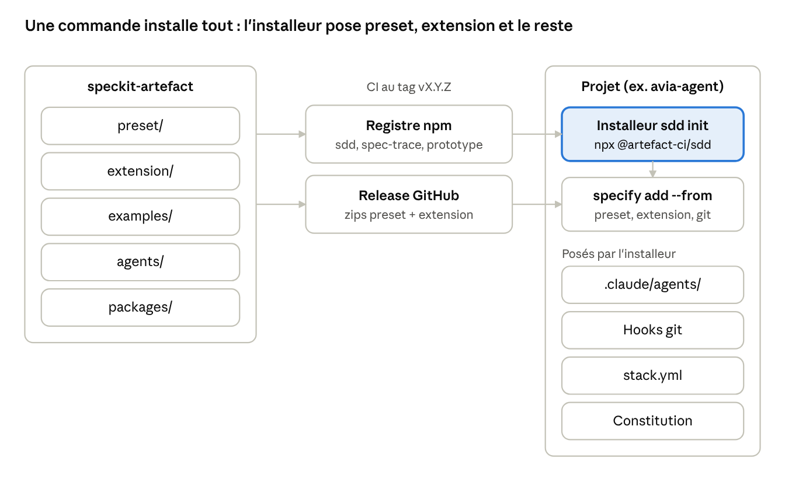
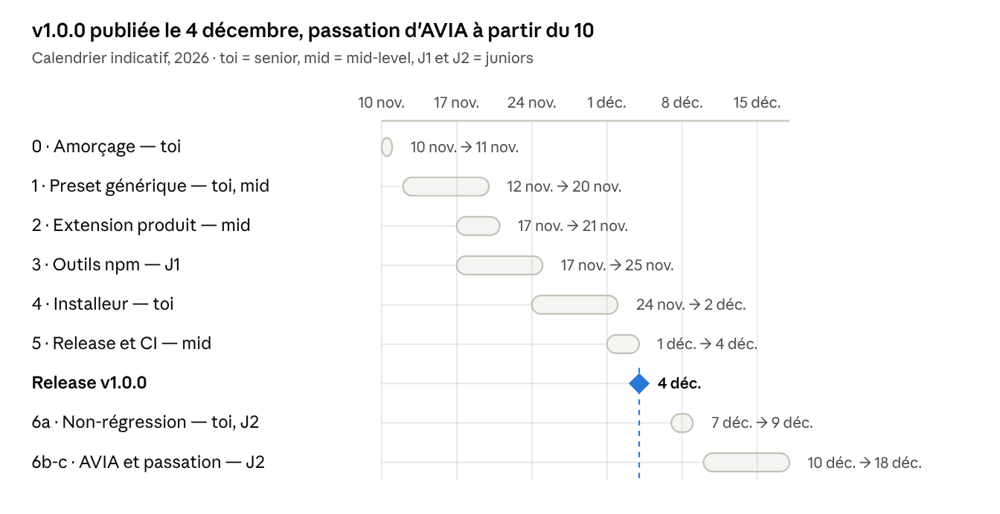

# Plan de création de artefact-ci/speckit-artefact

9 novembre 2026 · Al Moustapha Doumbia · version de travail : [doc en ligne](https://claude.ai/artifact/GxcuEYTftJ1HPkNSfGNJTb)

## Objectif et périmètre

`speckit-artefact` rend la méthode Spec Kit du boilerplate installable dans n'importe quel projet Artefact CI en une commande, quelle que soit sa stack. Premier client : AVIA (avia-agent en Bun + Hono, avia-client en Next.js), avant sa passation à un junior.

**Dans le périmètre**

- Le preset de méthode : templates spec, plan, tasks et règles TDD ajoutées à specify, plan, tasks, analyze, implement, converge.
- Les commandes produit : `/speckit-prd`, `/speckit-design`, `/speckit-epics`, `/speckit-prototype`.
- Les agents (designer, relecteur, relecteur-produit, relecteur-design) et leurs consignes.
- Les outils `spec-trace` et `prototype`, sortis du boilerplate.
- Un socle de constitution commun et un fichier `stack.yml` par projet.

**Hors périmètre**

- Un fork de Spec Kit : on reste sur le CLI officiel.
- La reprise de l'historique des projets : les specs `docs/superpowers` d'AVIA et d'ARAH restent où elles sont.
- Les règles propres à une stack (`tenant_id`, `AppError`, frontières Nx) : elles restent dans la constitution de chaque projet.

## Décisions prises et constats des tests

On ne forke pas Spec Kit : toutes les personnalisations passent par les mécanismes officiels, et le dépôt vise Spec Kit 1.3.2, version du boilerplate depuis le commit `b09a648`.

| Sujet | Décision ou constat | Conséquence pour le plan |
| --- | --- | --- |
| Fork | Rejeté : on deviendrait mainteneur d'un CLI qui évolue vite | preset + extension sur le CLI officiel |
| Bundle | Testé et fonctionnel dès 1.2.2, mais il ne remplace pas l'installeur et impose un catalogue | pas de bundle en v1 ; prévu comme évolution (voir Versionnement) |
| Installation sans bundle | `preset add --from` et `extension add --from` acceptent l'URL d'un zip (vérifié en 1.3.2) | l'installeur installe depuis la release GitHub, sans catalogue |
| Contraintes d'un bundle, pour plus tard | versions toutes figées (`git` 1.0.1 compris), `strategy` obligatoire pour un preset, composants venant d'un catalogue, `releases` limité aux anciennes versions, cache d'une heure | à appliquer le jour où on passe au bundle |
| Agents Claude Code | Une extension ne peut pas les installer dans `.claude/agents/` | l'installeur les copie |
| Hooks git | L'extension git arrive avec ses 18 hooks par défaut ; le boilerplate n'en garde que 10 | l'installeur réapplique la configuration |
| Montée de version | La procédure du guide passe en 1.3.2 sans toucher constitution, hooks ni sections « (boilerplate) » | procédure réutilisable telle quelle |

## Architecture cible

Un dépôt produit quatre pièces et un installeur : `npx @artefact-ci/sdd init` installe le preset et l'extension depuis la release GitHub, puis pose le reste.

| Pièce | Type | Contenu | Installée par |
| --- | --- | --- | --- |
| `artefact-sdd` | preset Spec Kit | templates spec, plan, tasks ; ajouts TDD à specify, plan, tasks, analyze, implement, converge ; socle de constitution | l'installeur, `specify preset add --from <zip>` |
| `artefact-product` | extension Spec Kit | `/speckit-prd`, `/speckit-design`, `/speckit-epics`, `/speckit-prototype` et leurs templates (prd, design, journeys) | l'installeur, `specify extension add --from <zip>` |
| `@artefact-ci/spec-trace`, `@artefact-ci/prototype` | paquets npm | traçabilité scénarios → tests ; maquettes HTML | `npx` / `bunx` à l'usage |
| `@artefact-ci/sdd` | installeur npm | installe l'extension git, l'extension et le preset ; copie les agents ; réapplique les hooks git ; génère `stack.yml` et la constitution | `npx @artefact-ci/sdd init` |



La CI publie sur deux canaux, le registre npm et la release GitHub. Dans le projet, l'installeur vient du premier et installe le preset et l'extension depuis le second.

Arborescence proposée :

```
speckit-artefact/
├── preset/              # artefact-sdd : preset.yml, templates/, commands/
├── extension/           # artefact-product : extension.yml, commands/, templates/
├── agents/              # designer, relecteur, relecteur-produit, relecteur-design + consignes
├── packages/
│   ├── spec-trace/
│   ├── prototype/
│   └── sdd/             # l'installeur
├── examples/stack/      # stack.yml types : nx, bun-hono, nextjs
└── .github/workflows/   # release : zips sur la release GitHub, publication npm
```

Les commandes ne citent plus de chemins ni d'outils du boilerplate : elles lisent `.specify/stack.yml`. Une clé absente fait sauter l'étape correspondante.

```yaml
# .specify/stack.yml — avia-agent
commands:
  test: bun test {file}
  affected: bun run lint && bun run typecheck && bun test
  check: bun run check
  trace: bunx @artefact-ci/spec-trace
tests:
  globs: ["src/**/*.test.ts"]
ui: null      # pas de front : /speckit-design et /speckit-prototype sautent ces étapes
e2e: null
```

## Phases de réalisation

Sept phases, dans l'ordre : chacune se termine par un critère vérifiable avant de passer à la suivante.

### Phase 0 — Amorçage du dépôt

- [ ] Créer `artefact-ci/speckit-artefact` (privé), branches `main` et `dev`, PR obligatoires vers `dev`.
- [x] Copier `tools/spec-kit/preset/` du boilerplate dans `preset/` avec son historique (`git filter-repo`, depuis la branche `dev` du boilerplate, `b30bb7b`).
- [x] Poser l'arborescence, un README et la CI.

Fini quand : `specify preset add --dev preset/` fonctionne sur un projet vierge en 1.3.2. Un projet vierge se crée avec `specify init --here` dans un dossier vide, puis `git init` : dans l'ordre inverse, `--non-interactive` refuse le dossier, qui n'est plus vide.

### Phase 1 — Preset générique `artefact-sdd`

- [x] Renommer le preset (`id: artefact-sdd`) et retirer les tags `nx`, `nestjs`, `react`.
- [x] Définir le schéma de `stack.yml` : branches, fichiers de conventions (`docs`), commandes (`test`, `affected`, `fresh`, `check`, `trace`), motifs de tests, code partagé (`shared`), `ui` (thème, composants, Storybook), `e2e`. Référence dans [`docs/stack.md`](stack.md), exemples dans `examples/stack/`.
- [x] Réécrire les six commandes du cœur pour lire `stack.yml` au lieu des chemins Nx (environ 40 références). Les règles propres à une stack (variables d'environnement, knip, domaines d'exemple…) ne sont plus dans les commandes : elles vivent dans les fichiers de conventions du projet, que `stack.yml` liste sous `docs`.
- [x] Rendre génériques les templates de plan et de tâches : ossature du cœur et sections du socle (Decisions for the User, Feature Flag, Test Strategy, Constitution Check sur les principes du projet). Les sections Nx passent dans un preset local du boilerplate, `examples/nx-preset/`, installé au-dessus d'`artefact-sdd` (priorité 5) ; son README liste les règles sorties du preset à retrouver dans les docs du boilerplate.
- [x] Extraire le socle de constitution : test-first, ids de scénario, incréments derrière un flag, une story par PR, relecture indépendante, spec tenue à jour. C'est le `constitution-template` du preset : quatre principes (Test-First, Flagged Increments, Independent Review, Living Specs) que les commandes citent par leur nom, puis ceux du projet.
- [x] Déplacer prd, design, epics, prototype et leurs templates du preset vers `extension/` (`artefact-product`), pour que le preset ne garde que le cœur.
- [x] Renommer ces commandes au format d'extension (`speckit.artefact-product.prd`…) et vérifier le nom des skills générées. Le renommage vient avec le déplacement : en 1.3.2, une commande d'extension nommée `speckit.prd` devient quand même la skill `speckit-artefact-product-prd`. Chaque commande garde son ancien nom en alias (`aliases: ['speckit.prd']`) : `/speckit-prd` et les autres marchent toujours.
- [x] Écrire la procédure de migration d'un projet qui a le preset `boilerplate` (voir Versionnement) et la tester sur un projet vierge.

Fini quand : `grep` ne trouve plus `nx`, `libs/`, `apps/` ni `pnpm` dans le preset, et l'extension s'installe avec `specify extension add --dev extension/` à côté du preset.

### Phase 2 — Extension `artefact-product`

- [x] Réécrire les quatre commandes pour lire `stack.yml` au lieu des chemins Nx, comme celles du cœur en phase 1. Le schéma gagne `ui.preview` (aperçu du thème, Storybook pour le boilerplate) et `ui.prototype` (outil de maquette). Les commandes s'arrêtent quand une consigne d'agent manque dans `docs/agents/` : la relecture ne se saute pas.
- [x] Rendre les étapes front (thème, Storybook, maquettes) conditionnelles à `ui` dans `stack.yml`. Sans front, `/speckit-design` écrit `design.md` sans direction visuelle ni thème, et `/speckit-prototype` s'arrête ; les parcours des epics deviennent des tests de bout en bout, pas forcément navigateur.

Vérifié le 9 novembre 2026 sur un projet vierge avec `examples/stack/bun-hono.yml` et les agents du boilerplate copiés à la main : les quatre commandes se lancent en mode non interactif (`claude -p`) ; prototype s'arrête, design, prd et epics vont jusqu'à leur question ou leur proposition, epics avec la relecture de `relecteur-produit`.

Fini quand : les quatre commandes s'installent et se lancent sur un projet sans front.

### Phase 3 — Outils npm

- [x] Sortir `tools/dev/spec-trace.mts` en `@artefact-ci/spec-trace` : motifs de tests configurables (`tests.globs` de `stack.yml`, ou `--tests`), même sortie que l'actuel. Le format des ids reste celui de la méthode : les commandes du preset et la constitution le citent, le rendre configurable dans le seul outil les ferait diverger.
- [x] Sortir `pnpm prototype` en `@artefact-ci/prototype` : le thème vient de `ui.theme` (ou `--theme`), Tailwind et Playwright du projet quand il les a.
- [x] Tests unitaires repris du boilerplate (`pnpm test:tools`), plus ceux de la lecture de `stack.yml` ; la CI les lance et empaquette les deux outils.
- [x] Publication sur npm public, scope `@artefact-ci` (`publishConfig.access: public`) : 0.1.0 publiée à la main le 9 novembre 2026, pour pouvoir déclarer la CI de release (phase 5) comme trusted publisher, qui publiera ensuite sans jeton.

Vérifié le 9 novembre 2026 avec les paquets empaquetés (`pnpm pack`, puis `npx --package=<tgz>`) : sur Afri Café, la matrice est identique à celle de `pnpm -s spec:trace` (toutes les specs, chaque spec en mode strict, `--base`, erreurs), et la maquette de `003-loyalty-status` donne le même `styles.css`, les mêmes polices et les mêmes captures (à l'animation d'un spinner près, qui varie aussi d'une exécution à l'autre de l'ancien outil). nx-react-nestjs n'a pas de spec : même sortie, « Aucune spec ». L'avertissement de dérive et `tests.globs` sont vérifiés sur un dépôt jetable, que les tests de la CLI reprennent avec des sorties produites par l'ancien outil. Le critère « Fini quand » est donc rempli avec les archives des paquets ; il reste à le rejouer avec `npx` depuis le registre, après la publication.

Fini quand : `npx @artefact-ci/spec-trace` donne la même matrice que `pnpm -s spec:trace` sur nx-react-nestjs et Afri Café.

### Phase 4 — Installeur `@artefact-ci/sdd`

- [ ] `init` : vérifie `uv`, lance `uvx --from specify-cli==1.3.2 specify init --here` si besoin (avec `--force` dans un dépôt existant, que `--non-interactive` refuse sinon), puis installe l'extension git, l'extension et le preset depuis les zips de la release (`--from`).
- [ ] Copie les agents dans `.claude/agents/` et leurs consignes dans `docs/agents/`.
- [ ] Réapplique les 10 hooks git du boilerplate dans `extensions.yml`.
- [ ] Détecte la stack (`nx.json`, `bun.lock`, `next.config.*`), propose un `stack.yml` à valider, écrit la constitution de base.
- [ ] `update` : même chose, sans écraser `stack.yml` ni la constitution du projet.

Fini quand : `init` lancé deux fois de suite laisse le dépôt identique (`git status` vide la deuxième fois).

### Phase 5 — Release et publication

- [ ] CI de release sur tag `vX.Y.Z` : zips du preset et de l'extension attachés à la release GitHub, publication des paquets npm.
- [ ] L'installeur porte les URL du tag qu'il installe et écrit la version installée dans `.specify/artefact.json`.
- [ ] Dans la CI de chaque PR : `specify preset add --dev` et `specify extension add --dev` sur un projet vierge.

Fini quand : `npx @artefact-ci/sdd@1.0.0 init` installe la version taguée sur un projet vierge, sans catalogue.

## Phase 6 — Validation

Le boilerplate devient le premier client du dépôt ; AVIA ne passe qu'une fois le boilerplate validé sans régression.

**6a. Non-régression sur nx-react-nestjs**

- [ ] Sur une branche, retirer `tools/spec-kit/preset/` et installer avec `npx @artefact-ci/sdd init`, avec un `stack.yml` Nx.
- [ ] Comparer les skills générées avant et après : seules les références à `stack.yml` doivent changer.
- [ ] `pnpm check` passe, et `npx @artefact-ci/spec-trace` donne la même matrice qu'avant.
- [ ] Rejouer `docs/tutorial/premiere-fonctionnalite.md` de bout en bout.
- [ ] Même chose sur Afri Café, après sa montée en 1.3.2.

**6b. Première installation sur AVIA**

- [ ] Trancher où vivent les specs des fonctionnalités qui touchent l'agent et le front (voir Risques et questions ouvertes).
- [ ] Installer dans avia-agent puis avia-client, écrire leurs `stack.yml`.
- [ ] Compléter la constitution AVIA : consentement tracé, vocabulaire multi-secteur (« client », jamais « patient »).
- [ ] Ne pas reprendre l'historique : les specs `docs/superpowers` restent en place.

**6c. Passation au junior**

- [ ] Première fonctionnalité menée par le junior avec la méthode : la tâche ClickUp « Retirer le vocabulaire santé hérité ».
- [ ] Relecture indépendante par le relecteur, puis par toi.

Fini quand : le junior a fusionné une story qui atteint **Converged** sans aide sur la méthode.

## Versionnement, release et maintenance

Une seule version pour tout le dépôt : le tag `vX.Y.Z` publie le preset, l'extension et les paquets npm ensemble, et un projet ne fige qu'un numéro.

- **SemVer** : MAJOR quand une commande ou un champ de `stack.yml` disparaît ou change de sens ; MINOR pour une commande ou une clé ajoutée ; PATCH pour la formulation.
- **Release GitHub** : les zips du preset et de l'extension, attachés au tag. Pas de catalogue Spec Kit en v1.
- **Version installée** : écrite par l'installeur dans `.specify/artefact.json`, lue par `update`.
- **Mise à jour d'un projet** : `npx @artefact-ci/sdd update`, qui réinstalle l'extension (`extension add --force`) et le preset (`preset update`) depuis la nouvelle release, puis réapplique agents et hooks.
- **Montée de Spec Kit** : faite d'abord dans `speckit-artefact` avec la procédure de `docs/guides/spec-kit.md`, validée sur le boilerplate, puis publiée en MINOR. Renovate ne suit pas Spec Kit : à vérifier chaque mois avec `specify self check`.
- **Changelog** : un `CHANGELOG.md` par release, avec ce qui change pour un projet déjà installé.
- **Migration depuis le preset `boilerplate`** : le changement d'id casse `specify preset update boilerplate`. Un projet qui l'a (nx-react-nestjs, Afri Café) migre ainsi, testé en 1.3.2 :
  1. `specify preset remove boilerplate` : supprime `.specify/presets/boilerplate/` et les skills prd, epics, design et prototype, et remet les six skills du cœur à leur version d'origine ;
  2. `specify preset add` du preset `artefact-sdd`, puis `specify extension add` de `artefact-product` (`--dev <chemin>` avant la phase 5, `--from <zip>` ensuite), après avoir écrit `.specify/stack.yml` ;
  3. pour garder les templates de plan et de tâches propres à sa stack, ajouter son preset local au-dessus (`specify preset add --dev <chemin> --priority 5`, voir `examples/nx-preset/`) ;
  4. remplacer dans la documentation du projet (`AGENTS.md`, guides, tutoriel) la commande `preset update boilerplate`. Les anciens noms de skills restent valables, en alias ;
  5. vérifier avec `specify preset list` et `git status` que seuls `.specify/` et `.claude/skills/` ont changé, en plus de la documentation.

  À partir de la phase 4, `npx @artefact-ci/sdd init` détecte le preset `boilerplate` et fait les étapes 1 et 2.
- **Bundle, plus tard** : quand d'autres équipes d'Artefact voudront la méthode sans passer par nous, ou qu'il faudra combiner plusieurs presets. On ajoute alors le catalogue et un `bundle.yml`, et l'installeur remplace ses trois commandes par `specify bundle add artefact`.

## Répartition et calendrier

En rythme normal, v1.0.0 sort en quatre semaines, et la passation d'AVIA démarre la semaine suivante. Les dates sont indicatives : elles supposent environ la moitié du temps de chacun sur ce chantier.



- **Toi** : les pièces critiques, c'est-à-dire la réécriture du preset et l'installeur, plus la relecture finale de chaque phase.
- **Mid** : l'extension, la release et la CI ; il relit le travail de J1.
- **J1** : les outils npm. Le périmètre est bien délimité et des tests existent déjà dans le boilerplate.
- **J2** : le junior qui reprend AVIA. Il entre dès la non-régression, pour apprendre la méthode sur le boilerplate avant de l'installer sur AVIA.

Personne ne valide son propre travail : chaque PR est relue par un autre membre de l'équipe.

## Risques et questions ouvertes

Le plus gros risque est la réécriture des commandes autour de `stack.yml` : une consigne devenue vague réduit la qualité du travail de l'agent sans que rien n'échoue.

| Risque | Parade |
| --- | --- |
| Commandes génériques moins précises que les commandes Nx | Comparer les skills avant et après (phase 6a) ; garder des exemples concrets dans `examples/stack/` |
| Spec Kit change de format (presets, extensions, noms de skills) | Version figée partout ; montée testée d'abord dans ce dépôt |
| L'installeur écrase une personnalisation locale | `update` ne touche ni `stack.yml` ni la constitution ; `git status` vérifié après chaque test |
| Un renommage de commande casse les habitudes (`/speckit-prd` devient un nom d'extension) | Les anciens noms restent en alias (vérifié en phase 1) ; annoncer les nouveaux noms dans le changelog |
| Le boilerplate et le dépôt divergent pendant la transition | Geler `tools/spec-kit/preset/` dès la phase 0 ; toute modification se fait dans `speckit-artefact` |

**À trancher**

- [ ] Où vivent les specs d'AVIA quand une fonctionnalité touche l'agent et le front : dans avia-agent, dans un dépôt `avia-specs`, ou en regroupant les deux dépôts en monorepo ?
- [ ] Les agents : copiés dans `.claude/agents/` par l'installeur, ou lus depuis `.specify/extensions/artefact-product/agents/` par un sous-agent générique (plus rien à copier, mais sans réglages d'outils ni de modèle) ?
- [x] Registre npm : npm public, scope `@artefact-ci` (tranché le 9 novembre 2026). Aucun jeton pour installer : `npx @artefact-ci/…` marche partout. Le code compilé des paquets devient public alors que ce dépôt est privé : ils sont sous licence MIT.
- [ ] Langue des commandes et des templates : anglais, comme aujourd'hui pour les specs, ou français ?
